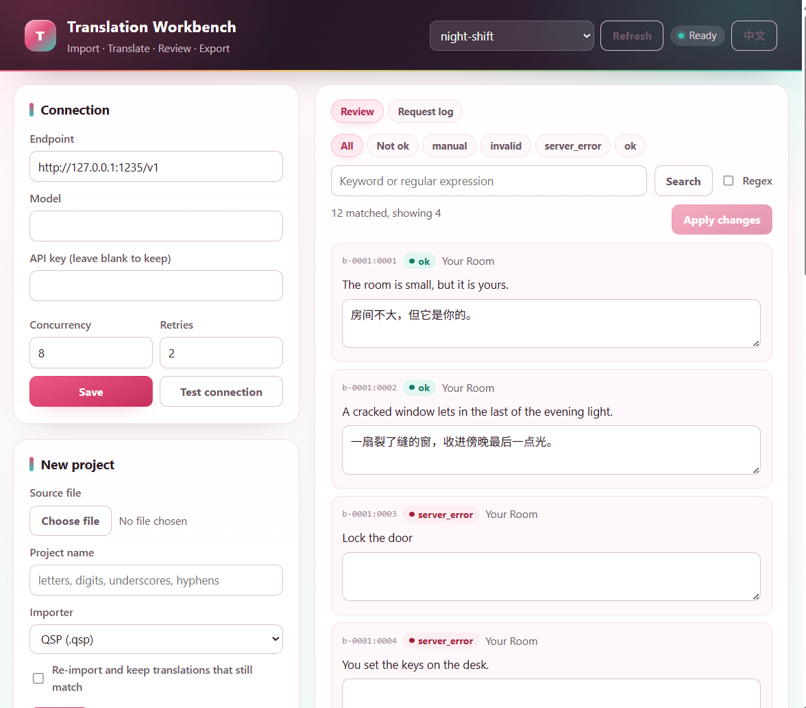
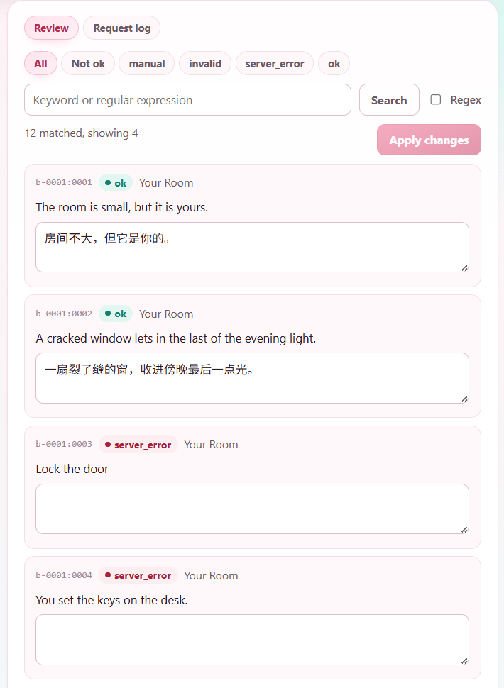
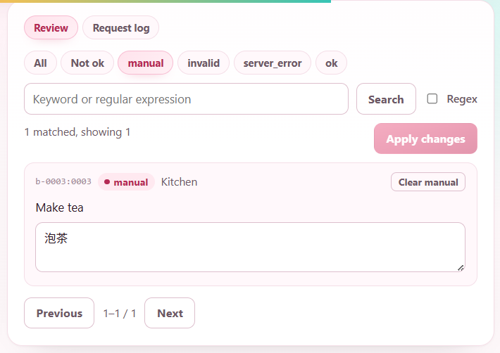
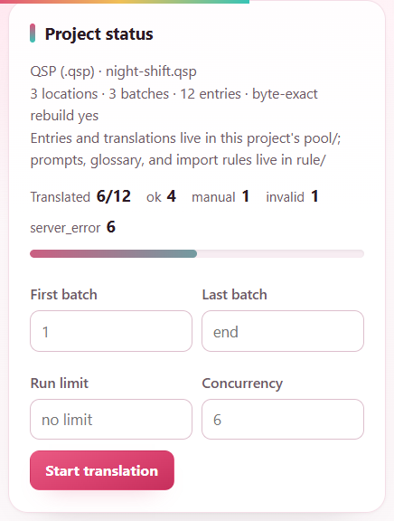
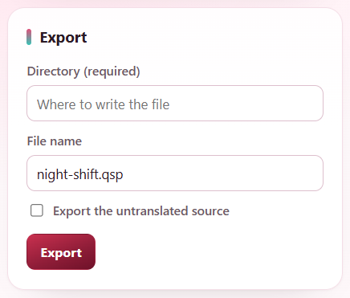

# QSP Localization Tool

English | [简体中文](README.zh-CN.md)

A local-first tool for importing, translating, reviewing, and exporting text from QSP games, Twine stories, chapter documents, and localization JSON. It provides a command-line interface and a browser UI. Project data stays in local files.

```text
source -> importer -> project pool -> AI translation -> review -> export
```



## Requirements

- Node.js 18 or later.
- An OpenAI-compatible endpoint for AI translation. The tool supports the Responses API and Chat Completions.
- A supported source file: `.qsp`, `.html` or `.htm` (Twine 2 / SugarCube), `.json` (source-to-translation map), or `.md`, `.markdown`, or `.txt`.

The QSP converter is included in the repository. No package installation is needed.

## Quick start

1. Copy the API settings template and fill in your endpoint and model:

   ```powershell
   Copy-Item rule\api.example.json rule\api.json
   ```

   The same values can be entered in the UI's Connection card, which writes the same file. An API key can come from that file or from `OPENAI_API_KEY`; `OPENAI_BASE_URL` and `OPENAI_MODEL` also work as environment variables.
2. Start the browser UI:

   ```powershell
   npm run ui
   ```

   On Windows, `start-ui.bat` starts the same UI and forwards its arguments. The server listens on localhost and opens the page at [http://127.0.0.1:4173](http://127.0.0.1:4173).
3. Import a source file, translate it, review the result, and export it. Stop the server from the UI or press Ctrl+C.

The UI opens in English. The 中文 button in the header switches it to Chinese, and the browser remembers the choice; the screenshots in [README.zh-CN.md](README.zh-CN.md) show the Chinese interface.

## Supported formats

- **QSP (`.qsp`)**: extracts translatable text from locations, actions, and code literals. The importer preserves format-specific structure when building the output.
- **Twine 2 / SugarCube (`.html`, `.htm`)**: extracts passage text and link or button labels; macros, code, comments, and link targets remain unchanged.
- **Localization JSON (`.json`)**: reads an object whose keys are source strings and values are existing translations. The output preserves key order.
- **Chapter text (`.md`, `.markdown`, `.txt`)**: splits text at chapter headings and imports non-empty paragraphs. A directory is merged in file-name order.

## Translation and review

Each project stores entries in a translation pool, one file per batch. A translation is submitted unless its status is `ok` or `manual`.

| Status | Meaning | Next translation run |
|---|---|---|
| `server_error` | Not translated yet, or the request or response could not be completed | Submitted again |
| `invalid` | A response was received but failed the format check | Submitted again |
| `ok` | Passed the importer's format check | Skipped |
| `manual` | Applied by the user | Skipped until reopened |

Failures are recorded per entry; they do not clear saved translations in the same batch. To return a manually edited entry to the AI queue, use the UI's reopen action or the `reopen` command. The existing text is kept.

The review panel filters by status and searches the source text or the translation. An edit is applied with `应用修改` and becomes `manual`.



A `manual` entry is never submitted again by itself. Its `取消 manual` button keeps the text and puts the entry back in the queue as `server_error`.



## Command line

Commands can also be run through `node src/adapters/cli.mjs`. Use `--help` to see the current command list.

```text
node src/adapters/cli.mjs projects
node src/adapters/cli.mjs import <source|directory> <name> [--importer=qsp] [--rules file] [--glossary file] [--rebuild]
node src/adapters/cli.mjs translate <name> [--from=1] [--to=20] [--limit=100] [--conc=6]
node src/adapters/cli.mjs status <name>
node src/adapters/cli.mjs find <name> <query> [--status=ok,manual] [--regex] [--limit=20]
node src/adapters/cli.mjs edit <name> <changes.json>
node src/adapters/cli.mjs reopen <name> <entry-id...>
node src/adapters/cli.mjs build <name> [-o file | --dir directory] [--name=file] [--raw]
node src/adapters/cli.mjs check <name>
node src/adapters/cli.mjs ui [--port=4173]
```

`edit` accepts either an array such as `[{ "id": "b-0001:0001", "translation": "..." }]` or an object mapping an entry ID or source string to a translation. Edited entries become `manual`.

`build` requires an output path. Use `-o` for a file path or `--dir` for a directory; these options cannot be combined. `--name` changes the suggested file name when using `--dir`. `--raw` exports the untranslated source.

`--rebuild` reimports the source into a staging directory and replaces the project only after validation. It carries existing translations forward when entries match by ID or source text. The rebuild stops if an existing pool batch cannot be read.

## Project data

- `rule/` contains global defaults. Each new project gets its own copies of the prompt table, glossary, and importer rules.
- `rule/api.json` holds the local API settings, written by the Connection card or by hand. Do not share it if it contains a key.
- `project/<name>/source/` contains source files maintained by the importer. Treat them as read-only; edit translations in the pool or UI.
- `project/<name>/pool/` contains source text, translations, and statuses.
- `project/<name>/logs/ai-requests/` contains model request and response records. These records may include prompts and project text; review them before sharing.

For command-line imports, `--rules` and `--glossary` can provide project-specific files. In the UI, settings are saved to the selected project's copy. With no project selected, the prompt table and glossary are saved as global defaults.

The status card shows what is translated and how the batch range is selected; the export card writes the rebuilt file to a directory you choose.





## Tests

```powershell
npm test
```

Tests use local fixtures and do not call a live model endpoint. Keep fixtures small and synthetic; do not add real game, novel, or project text.

## License

The original code is licensed under [Apache-2.0](LICENSE). The vendored QSP converter retains its MIT license at [`importers/qsp/qsp-lib/@qsp/converters/LICENSE`](importers/qsp/qsp-lib/@qsp/converters/LICENSE). The QSP engine is a separate project and is not included.
